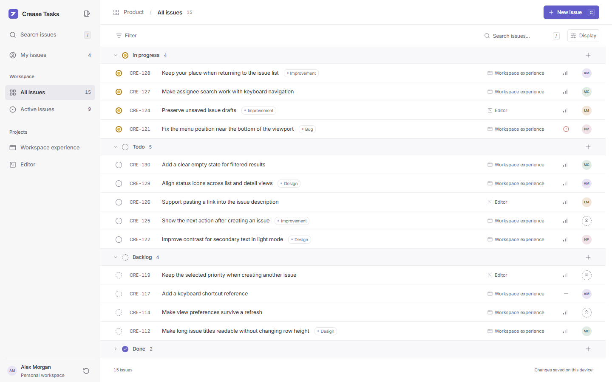
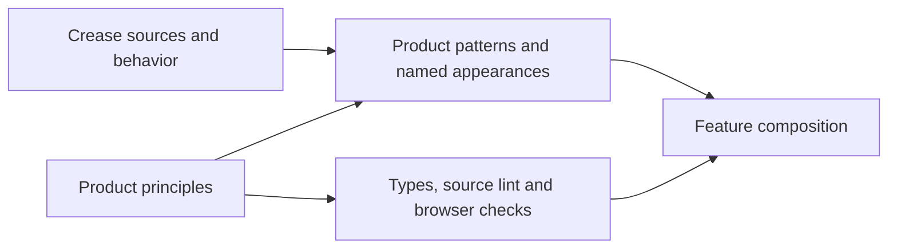
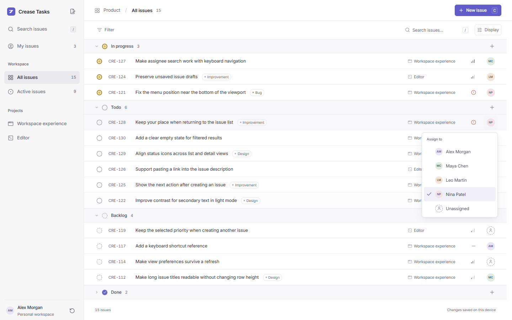
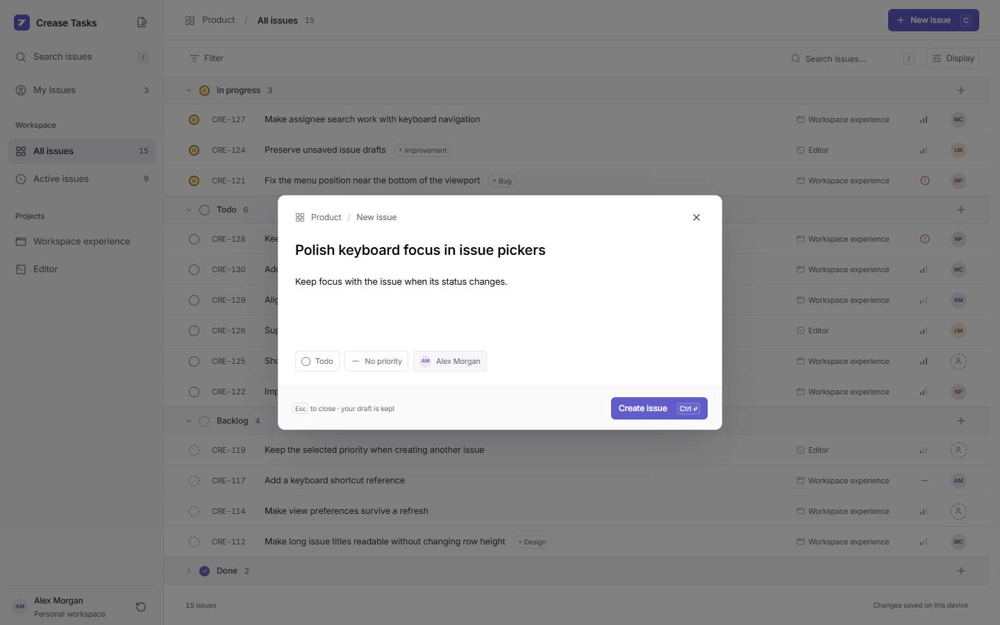

# A task list needs a vocabulary

Status: pilot essay accompanying the first local visual review. This is a working
checkpoint, not a frozen chapter branch or a claim that the larger lint release
is complete. The executable source is this repository; start with
[the product brief](../../design-system/product-brief.md).

Architecture review: this draft's source currently centralizes component CSS and
rebuilds navigation without the available Crease Sidebar. Its closed public APIs
demonstrate only part of the intended boundary. Component-owned Tailwind styling,
foundation reuse and active authoring checks must be repaired before publication.
See [the review correction](../../design-system/review-notes.md).

A task list offers dozens of small opportunities to disagree with yourself.
One screen uses a compact button. Another adds a little padding. Assignment opens
a menu here and a dialog there. The issue title, identifier and project name each
look reasonable on their own. Together, they compete for attention.

A library of good components does not settle those decisions. It gives us the
parts from which to make them. This tutorial turns Crease's parts into the smaller
vocabulary of one product: Crease Tasks.

We start with a light issue list, not a collection of disconnected examples.
The same issue must retain its identity when it changes status, enters a personal
view, is filtered out, and returns after a reload. That makes design consistency
observable in the work someone is doing.



## Give attention a job

Linear's 2026 refresh describes making supporting navigation and decoration
quieter, and making action placement more predictable. Those are useful principles
to study; they are not a set of pixel measurements to copy.
[A calmer interface for a product in motion](https://linear.app/now/behind-the-latest-design-refresh)

In our first slice, the title is the thing to read. The identifier is the thing
to reference. The project is context. Priority and assignment are small controls.
Those responsibilities produce one row geometry, repeated across every view.

The sidebar orients you. A location header tells you where you are and keeps
creation in a predictable place. A second row changes the current view through
search, filtering and ordering. We do not add a dashboard summary above the work
just to fill space.

Our proposed values include 44px issue rows and a 236px navigation rail. These
are product decisions for review, not claims about Linear's implementation.
Secondary text still has to remain readable. The first rendered accessibility
pass caught colors that looked pleasantly quiet in a screenshot but were too
light. We changed the shared roles, rather than adding a darker exception to
each affected row.

## Narrow the choice at the feature boundary

Crease's copied Button is deliberately adaptable. A product does not have to
expose all that adaptability to every feature:

```ts
action(
  {
    label: "New issue",
    icon: "plus",
    onClick: Message.OpenedComposer({ status: "todo" }),
    keys: "C",
    id: "new-issue-trigger",
  },
  h,
);
```

The public action has an intent, a label and an event. It has no class, style,
radius, color or size argument. Its implementation maps that intent to named
appearances in the source-owned Crease Button:

```ts
variant: props.intent === "quiet"
  ? "taskQuiet"
  : props.intent === "outline"
    ? "taskOutline"
    : "taskPrimary";
```

This narrows the feature's choices, but the current named variants still point to
global CSS hooks. The repair must move actual appearance into the owned Button
source; a finite variant name alone does not establish styling ownership.
The wrapper is in
[primitives.ts](../../src/design/primitives.ts), and the adapted foundation is
[button.ts](../../src/ui/button.ts).

The distinction matters when an agent edits the app. A task to add a feature
does not require it to tune button geometry. A task to change the product's
button policy does require changing the owned source and checking its consumers.
Both kinds of work are legitimate. They have different scopes.



## Edit the small thing where it is

An assignee is a finite choice. Editing it should preserve the list around it.
Our AssigneePicker owns the trigger, option vocabulary, checked state and
presentation. Rows and creation use the same pattern.



Linear documents direct assignment from collection avatars as well as issue
properties. We adapt that idea to our small sample team.
[Assign and delegate issues](https://linear.app/docs/assigning-issues)

The feature owns the issue's durable assignee. The menu owns whether it is open
and which option is active. They are separate models:

```ts
const before = model.rows[message.issueId]?.[message.field];
if (before === undefined) return { model };
const result = Menu.update(before, message.message);
```

The returned child model replaces that child state. A selection out-message
updates the issue using the shared schema vocabulary. The feature does not
reach into a child model to set its active index or open flag. The complete
update is in [model.ts](../../src/model.ts).

Changing the data is only part of the interaction. Keyboard focus must follow
the actual option as Arrow keys move, then return to the trigger when the menu
closes. A status change can move that trigger to another group. A filter can
remove it altogether. The app focuses after the DOM commit and has a fallback
to the collection heading:

```ts
Dom.focus(selector, { preventScroll: true }).pipe(
  Effect.catch(() => Dom.focus("#issue-list-heading", { preventScroll: true })),
  Effect.match({
    onFailure: () => Message.CompletedEffect(),
    onSuccess: () => Message.CompletedEffect(),
  }),
);
```

A highlighted option with focus still on a container is not the same behavior.
Neither is a changed status whose keyboard focus disappears with the old row.
These are browser assertions, not things a source lint rule can establish.

## Keep an explicit commit boundary for creation

Menus are useful for small property changes. That does not make every dialog a
design failure. Linear's creation workflow uses a focused composer and retains
drafts; our first slice uses a smaller version of that pattern.
[Creating issues](https://linear.app/docs/creating-issues)



The draft is not yet an issue. Submitting an empty title reports a useful error
and focuses the field. Closing keeps the draft during the session. Successful
submission creates one domain record, persists it and clears the draft. This
checkpoint does not persist drafts across reload, and it does not imply that it
does.

Testing this flow exposed a boundary between two otherwise useful interactions.
After choosing an assignee, focus returned to its trigger. Ctrl+Enter then reached
the trigger's Enter handler and reopened the menu. The product shortcut never got
the event. The source-owned menu now leaves modified Enter to its enclosing
workflow:

```ts
if (modifiers.ctrlKey || modifiers.metaKey || modifiers.altKey) return Option.none();
```

That change lives in the copied component, not in an extra click handler on this
one screen. The product subscription can then implement Control/Command+Enter
once. Shortcut hints reflect the platform, and shortcuts are suppressed while
typing unless the individual binding explicitly allows them.

## Make the enforcement boundary visible

The strict lint package is a packed snapshot of the reviewed Crease baseline.
Our product export contracts are explicit because that baseline's installer
inference is still incomplete. The initial lint checks feature code and the
product import boundary. Known authoring sources are excluded by exact paths;
a new neighboring source file does not inherit that exclusion.

The negative checks deliberately try raw layout, a raw button, a class builder,
asserted appearance props, a base-component import from a feature and an
unregistered button beside the installed components. They fail. The real feature
code passes. That is more useful evidence than a rule enabled in a config file.

It is also a limited claim. The entire component-authoring policy, generated
installer contracts, all product-specific rules and the full renderer/theme
matrix belong to later checkpoints. An instruction in AGENTS.md is not an
execution sandbox. Source lint is not a visual reviewer.

| Decision                                            | Mechanism in this slice                                        |
| --------------------------------------------------- | -------------------------------------------------------------- |
| Features do not choose arbitrary control appearance | Closed product APIs, strict call checks and an import boundary |
| Status/priority/assignee choices agree everywhere   | Shared schemas and picker patterns                             |
| Edits are actual data operations                    | Feature updates, persistence commands and reload checks        |
| Menus and creation cooperate with the keyboard      | Child updates, after-commit focus and browser workflows        |
| The interface looks coherent                        | Shared product styles plus human review of real states         |

## Run the whole program

The app is a normal Foldkit program. The complete Model, init, update,
subscriptions and view are provided as source files, not hidden behind the
single action example above. [entry.ts](../../src/entry.ts) starts it:

```ts
import "./styles.css";
import { Runtime } from "foldkit";
import { Model, Flags, flags, init, update, subscriptions } from "./model";
import { view } from "./view";

Runtime.run(
  Runtime.makeElement({
    Model,
    Flags,
    flags,
    init,
    update,
    view,
    subscriptions,
    container: document.getElementById("root"),
    devTools: false,
  }),
);
```

Use the working source alongside this essay. Inspect an issue update, a picker,
its named appearance and the feature contract together. The first review is about
whether those decisions produce the right product. After that review, we can
freeze a runnable version and teach how to change it without losing its rules.
